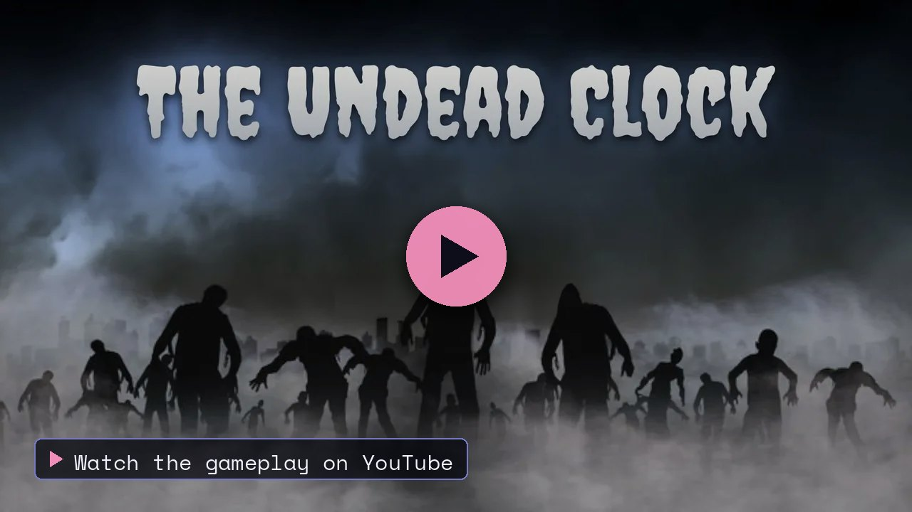
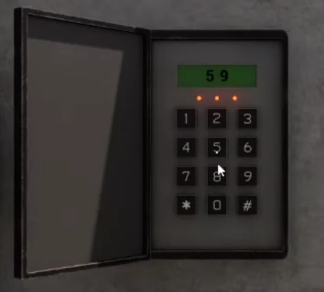
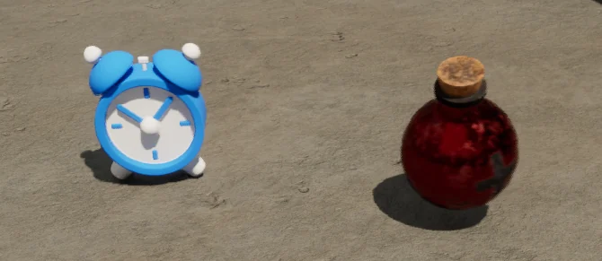

<a href="https://thibautplatet.com/en/projects/the-undead-clock.html"><picture><source media="(prefers-color-scheme: dark)" srcset="https://raw.githubusercontent.com/ThibPltt/ThibPltt/main/assets/repos/The-Undead-Clock-dark.svg"><source media="(prefers-color-scheme: light)" srcset="https://raw.githubusercontent.com/ThibPltt/ThibPltt/main/assets/repos/The-Undead-Clock-light.svg"></picture></a>

# The Undead Clock

Survival mini-game in Unreal Engine 5, built entirely in Blueprints.

| At a glance | |
|---|---|
| **Dates** | 2025 – 2026 |
| **Context** | survival mini-game · solo project · ENSIM |
| **Technologies** | Unreal Engine 5 · Blueprints |
| **Video** | [Gameplay on YouTube](https://www.youtube.com/watch?v=hAo6v7G74Nc) |
| **Case study** | [thibautplatet.com/en/projects/the-undead-clock.html](https://thibautplatet.com/en/projects/the-undead-clock.html) |

## Problem

Escape from an industrial complex overrun by zombies, with limited time and limited health.

## Role

Solo project.

## The game

You wake up in an industrial complex, surrounded by zombies. A weapon to pick up, waves that get fiercer and fiercer to hold off, and a single goal: get out of the factory before time or health runs out.

Clues are hidden around the level: they give the code of the final door.

## How it was built, and the result

A solo project in Unreal Engine 5, built entirely in Blueprints.

- A wave system, and doors tied to those waves.
- A countdown, health points and two pick-ups.
- An interactive keypad, on which a code is really typed.
- A main menu.

**Result:** a playable game, shown on video, with nine waves to hold off, five doors to get through and a final puzzle.

## Specification

| Rule | Implementation |
|---|---|
| Survive | Waves of zombies that get fiercer and fiercer; a weapon to pick up at the start. |
| Constraints | Limited time and limited health. |
| Pick-ups | Health: +10 HP. Time: +15 seconds. |
| Progress | Doors open according to the waves held off (see below). |
| Escape | A code, pieced together from hidden clues, is typed on an interactive keypad to open the final door. |

## Progression

1. Wave 2: door 1
2. Wave 4: door 2
3. Wave 6: door 3
4. Wave 8: door 4
5. Wave 9: final door with the code

<table>
  <tr>
    <td width="42%"></td>
    <td width="58%"></td>
  </tr>
  <tr>
    <td>The keypad of the final door: the code found thanks to the clues is typed on it.</td>
    <td>The two pick-ups: time (+15 s) and health (+10 HP).</td>
  </tr>
</table>

## In the project

All the logic is in `Content/Blueprints/`:

- **Waves** · `Zombie/Spawner/BP_EnemySpawner`, driven by a data table (`DT_WavePoolData`).
- **Zombie AI** · `BP_AIController` running a behaviour tree (`BT_EnemyAI`) with roam and attack tasks, a player-locating service and a health bar widget (`WBP_AIHealthBar`).
- **Doors and keypad** · one door per stage (`Door/Door1` to `Door/Door5`); the last one opens with `Door5/Keypad/BP_Keypad` and its widget `WBP_Keypad`, through the `BPI_InteractionKeypad` and `BPI_UnlockDoor` interfaces.
- **Pick-ups and countdown** · `Collectables/BP_Clock` (+15 s) and `Collectables/BP_Potion` (+10 HP), `BP_Clock` for the timer.
- **Weapons** · a base class (`Weapons/BP_BaseWeapon`) with a full-auto child and matching pick-ups in `WeaponsPickup/`.
- **Menu and level flow** · `Interfaces/WBP_MainMenu`, `BP_MenuGameMode`, an elevator (`Elevator/BP_Elevator`) and the final button (`End/`).

## Run it

1. Install **Unreal Engine 5.2**.
2. Clone the repository and open `The_Undead_Clock.uproject`.
3. Press **Play**: the game starts on the main menu (`Content/FirstPerson/Maps/MainMenuMap`).

## Credits

Game design, level scripting and Blueprints: **Thibaut Platet**.
Environment, characters, animations, weapons and VFX come from third-party packs (Abandoned Power Plant, Zombie Animation Pack, Anim Starter Pack, FPS Weapon Bundle, Realistic Starter VFX Pack Vol. 2) and free sound libraries; they keep their own licences.
